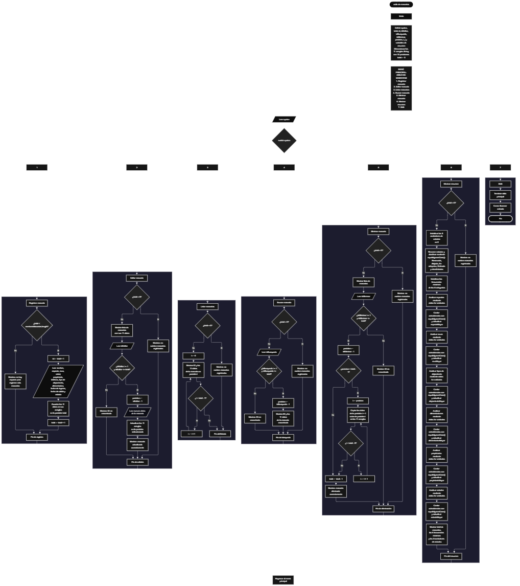

Este proyecto, llamado <b>asilo de mascotas</b>, fue desarrollado en <b>java</b> como un ejercicio práctico para fortalecer la lógica de programación mediante la creación de un sistema de gestión de mascotas desde la consola. El programa cuenta con un menú principal de siete opciones que permite <b>registrar, editar, listar, buscar, eliminar y consultar resúmenes estadísticos</b> de las mascotas registradas. Cada mascota almacena datos como el nombre, la especie, la raza, la edad, el propietario, el teléfono, el tipo de alojamiento, la alimentación, la fecha de ingreso, la fecha de salida y el estado, utilizando once arreglos paralelos con una capacidad máxima de <b>10 mascotas durante la ejecución</b>. Durante su desarrollo se aplicaron conceptos fundamentales de programación, como variables, arreglos, estructuras condicionales, ciclos repetitivos y estructuras de selección, además de procesos para buscar, modificar, eliminar, reorganizar registros y analizar frecuencias. Este proyecto permite poner en práctica los conocimientos adquiridos en java y sirve como base para desarrollar sistemas de gestión más avanzados utilizando otros lenguajes y tecnologías.

<h2 align="center">⚙️ Funcionamiento del menú principal</h2>

### ➕ Registrar mascota

La opción <b>1) registrar mascota</b> permite almacenar una nueva mascota en el sistema. Antes de realizar el registro, el programa comprueba que la cantidad de mascotas almacenadas sea menor que la capacidad de los arreglos, utilizando la condición <b>total >= nombresMascotas.length</b> para determinar si se ha alcanzado el límite máximo de <b>10 registros</b>. Si existe espacio disponible, genera el identificador mediante la variable <b>id</b>, utilizando la operación <b>total + 1</b>, y solicita el <b>nombre de la mascota, especie, raza, edad, nombre del propietario, teléfono del propietario, tipo de alojamiento, tipo de alimentación, fecha de ingreso, fecha de salida y estado de la mascota</b>. Los datos se almacenan en la posición correspondiente de sus respectivos arreglos. Finalmente, muestra el mensaje <b>"mascota registrada correctamente."</b> e incrementa la variable <b>total</b> en uno. Si los arreglos alcanzan su capacidad máxima, presenta el mensaje <b>"no hay espacio para registrar más mascotas."</b>, impidiendo agregar otro registro.

### ✏️ Editar mascota

La opción <b>2) editar mascota</b> permite modificar la información de una mascota registrada. Primero, el programa comprueba si existen mascotas almacenadas mediante la variable <b>total</b>. Si no hay registros, muestra el mensaje <b>"no existen mascotas registradas."</b>. En caso contrario, utiliza un ciclo <b>for</b> para recorrer los registros y presentar el ID, nombre, especie, raza, edad, propietario, teléfono, alojamiento, alimentación, fecha de ingreso, fecha de salida y estado de cada mascota. Después, solicita el identificador de la mascota que se desea editar y comprueba que esté dentro del rango permitido mediante la condición <b>idEditar >= 1 && idEditar <= total</b>. Si la selección es válida, obtiene la posición correspondiente mediante <b>posicion = idEditar - 1</b> y solicita nuevamente los once datos de la mascota, actualizando directamente los valores de los arreglos correspondientes. Finalmente, presenta el mensaje <b>"mascota actualizada correctamente."</b>. Si el identificador no corresponde a un registro existente, muestra el mensaje <b>"id no encontrada."</b>.

### 📋 Listar mascotas

La opción <b>3) listar mascotas</b> permite visualizar todas las mascotas registradas actualmente en el sistema. Antes de mostrar la información, el programa comprueba si la variable <b>total</b> es igual a cero. Si no existen registros, presenta el mensaje <b>"no existen mascotas registradas."</b>. Si hay mascotas disponibles, muestra el encabezado <b>"lista de mascotas"</b> y utiliza un ciclo <b>for</b> para recorrer los once arreglos desde la primera posición hasta el número total de registros almacenados. Durante el recorrido, muestra el identificador y los once datos correspondientes a cada mascota. Esta función facilita consultar la información de todos los registros sin necesidad de buscar cada mascota individualmente.

### 🔎 Buscar mascota

La opción <b>4) buscar mascota</b> permite localizar una mascota mediante su identificador. Primero, el programa comprueba si existen mascotas registradas. Si no hay registros, muestra el mensaje <b>"no existen mascotas registradas."</b>. En caso contrario, solicita el identificador mediante la variable <b>idBusqueda</b> y comprueba que esté dentro del rango permitido utilizando la condición <b>idBusqueda >= 1 && idBusqueda <= total</b>. Si el identificador es válido, calcula la posición mediante <b>posicion = idBusqueda - 1</b> y muestra los datos completos de la mascota encontrada: nombre, especie, raza, edad, propietario, teléfono, alojamiento, alimentación, fecha de ingreso, fecha de salida y estado. Si el identificador introducido no corresponde a una mascota registrada, presenta el mensaje <b>"id no encontrada."</b>. La búsqueda se realiza directamente mediante el ID, sin recorrer los arreglos para comparar nombres.

### 🗑️ Eliminar mascota

La opción <b>5) eliminar mascota</b> permite eliminar una mascota mediante su identificador. Antes de comenzar, el programa comprueba que existan registros almacenados. Si no hay mascotas, muestra el mensaje <b>"no existen mascotas registradas."</b>. Si existen registros, utiliza un ciclo <b>for</b> para presentar la información de las mascotas disponibles. Después, solicita el ID que se desea eliminar mediante la variable <b>idEliminar</b> y verifica que esté dentro del rango válido utilizando la condición <b>idEliminar >= 1 && idEliminar <= total</b>. Si la mascota existe, calcula su posición mediante <b>posicion = idEliminar - 1</b> y comienza el proceso de reorganización. Para mantener los registros ordenados, utiliza un ciclo <b>for</b> controlado por la variable <b>i</b>, que desplaza una posición hacia atrás los datos de las mascotas posteriores en los once arreglos: <b>nombresMascotas, especies, razas, edades, propietarios, telefonos, tiposAlojamiento, alimentaciones, fechasIngreso, fechasSalida y estados</b>. Posteriormente, disminuye la variable <b>total</b> en uno y muestra el mensaje <b>"mascota eliminada correctamente."</b>. Si el identificador no corresponde a una mascota registrada, presenta el mensaje <b>"id no encontrada."</b>.

### 📊 Mostrar resumen

La opción <b>6) mostrar resumen</b> permite consultar información estadística sobre las mascotas registradas. Primero, el programa comprueba si existen registros mediante la variable <b>total</b>. Si no hay mascotas, muestra el mensaje <b>"no existen mascotas registradas."</b>. En caso contrario, inicializa cinco contadores para clasificar los estados: <b>reservadas, alojadas, enAdopcion, retiradas y otrosEstados</b>. Después, utiliza un ciclo <b>for</b> para recorrer el arreglo <b>estados</b> y comparar cada valor mediante <b>equalsIgnoreCase()</b>, contabilizando las mascotas reservadas, alojadas, en adopción, retiradas y aquellas que pertenecen a otros estados. Posteriormente, realiza seis análisis de frecuencia mediante ciclos <b>for</b> anidados, utilizando comparaciones con <b>equalsIgnoreCase()</b> para identificar la especie más frecuente, la raza más frecuente, el tipo de alojamiento más utilizado, el tipo de alimentación más frecuente, el propietario con más mascotas y el estado más frecuente. Finalmente, muestra el total de mascotas registradas, los seis resultados de frecuencia y los cinco contadores de estados. Esta función permite obtener una visión general de la información almacenada en el sistema.

### 🚪 Salir del menú principal

La opción <b>7) salir</b> está destinada a finalizar la ejecución del programa y muestra el mensaje <b>"gracias por utilizar asilo de mascotas."</b>. El menú principal se encuentra dentro de una estructura repetitiva <b>do-while</b>, que mantiene el programa en funcionamiento mientras la opción seleccionada sea diferente de <b>7</b>. Cuando el usuario selecciona esta opción, el ciclo finaliza y posteriormente se ejecuta la instrucción <b>entrada.close()</b>, que cierra el objeto <b>Scanner</b> utilizado para capturar los datos desde la consola.

<h2 align="center">🧠 Temas aplicados en el proyecto</h2>

### 📦 Variables

En este proyecto se utilizan variables para almacenar la opción seleccionada en el menú, controlar la cantidad de mascotas registradas, generar identificadores, seleccionar las posiciones de los registros que se desean editar, buscar o eliminar, recorrer los arreglos y realizar los diferentes cálculos estadísticos. También se utilizan variables para contabilizar los estados de las mascotas, identificar las categorías con mayor frecuencia y almacenar los resultados de los análisis realizados.

🔢 **Opcion:** Almacena la opción seleccionada por el usuario en el menú principal.

📊 **Total:** Controla la cantidad actual de mascotas registradas.

🆔 **Id:** Almacena el identificador generado para una nueva mascota.

✏️ **IdEditar:** Almacena el identificador de la mascota que se desea modificar.

🔎 **IdBusqueda:** Almacena el identificador de la mascota que se desea buscar.

🗑️ **IdEliminar:** Almacena el identificador de la mascota que se desea eliminar.

📍 **Posicion:** Determina la posición correspondiente a la mascota seleccionada dentro de los arreglos.

🔄 **I:** Funciona como contador en los ciclos <b>for</b> utilizados para recorrer y reorganizar los registros.

🔁 **J:** Controla los ciclos internos utilizados para comparar los datos y calcular las frecuencias de los diferentes elementos.

📊 **Reservadas, alojadas, enAdopcion, retiradas y otrosEstados:** Almacenan las cantidades de mascotas clasificadas según su estado.

🐾 **EspecieMayor, razaMayor, alojamientoMayor, alimentacionMayor, propietarioMayor y estadoMayor:** Almacenan los valores que presentan la mayor frecuencia en sus respectivos análisis.

🔢 **CantidadEspecieMayor, cantidadRazaMayor, cantidadAlojamientoMayor, cantidadAlimentacionMayor, cantidadPropietarioMayor y cantidadEstadoMayor:** Almacenan las frecuencias máximas encontradas durante los análisis estadísticos.

### 🗃️ Arreglos

En este proyecto se utilizan once arreglos paralelos relacionados con los datos de cada mascota. Cada arreglo tiene una capacidad de <b>10 posiciones</b> y utiliza el mismo índice para representar la información correspondiente a un mismo registro. Por ejemplo, los datos de una mascota almacenada en la posición <b>0</b> se encuentran distribuidos entre <b>nombresMascotas[0], especies[0], razas[0], edades[0], propietarios[0], telefonos[0], tiposAlojamiento[0], alimentaciones[0], fechasIngreso[0], fechasSalida[0] y estados[0]</b>. Esta organización permite recorrer, buscar, modificar, mostrar y eliminar las mascotas de manera ordenada.

🐾 **NombresMascotas[10]:** Almacena los nombres de las mascotas registradas.

🧬 **Especies[10]:** Almacena las especies correspondientes a cada mascota.

🐕 **Razas[10]:** Almacena las razas de las mascotas.

🎂 **Edades[10]:** Almacena las edades de las mascotas.

👤 **Propietarios[10]:** Almacena los nombres de los propietarios.

📞 **Telefonos[10]:** Almacena los teléfonos de los propietarios.

🏠 **TiposAlojamiento[10]:** Almacena los tipos de alojamiento de las mascotas.

🍖 **Alimentaciones[10]:** Almacena los tipos de alimentación de las mascotas.

📅 **FechasIngreso[10]:** Almacena las fechas de ingreso de las mascotas.

📆 **FechasSalida[10]:** Almacena las fechas de salida de las mascotas.

📌 **Estados[10]:** Almacena los estados actuales de las mascotas.

### 🔀 Estructuras condicionales

En este proyecto se utilizan las estructuras <b>if</b>, <b>else if</b> y <b>else</b> para comprobar si existen mascotas registradas antes de ejecutar determinadas operaciones, verificar la capacidad disponible de los arreglos, validar los identificadores seleccionados para editar, buscar o eliminar una mascota y clasificar los registros según su estado. También se utilizan condiciones para comparar las frecuencias encontradas durante los análisis estadísticos y determinar si un valor supera la frecuencia máxima actual. Estas estructuras permiten que el programa responda de manera diferente según las condiciones y los resultados de cada operación.

### 🔄 Estructuras repetitivas

En este proyecto se utilizan los ciclos <b>do-while</b> y <b>for</b>. El ciclo <b>do-while</b> mantiene activo el menú principal y permite ejecutar las diferentes opciones hasta que el usuario selecciona la opción <b>7</b>. Por otro lado, los ciclos <b>for</b> permiten recorrer los arreglos para mostrar, consultar y reorganizar las mascotas registradas. También se utilizan ciclos <b>for</b> anidados para comparar los elementos de los arreglos y calcular las frecuencias de especies, razas, tipos de alojamiento, alimentaciones, propietarios y estados.

### 🎯 Estructura según

El programa utiliza la estructura <b>switch</b> para evaluar el valor almacenado en la variable <b>opcion</b> y ejecutar el bloque de instrucciones correspondiente. Cada caso representa una operación específica del sistema: <b>registrar mascota, editar mascota, listar mascotas, buscar mascota, eliminar mascota, mostrar resumen o salir</b>. También se utiliza el bloque <b>default</b> para presentar el mensaje <b>"opción no válida."</b> cuando el usuario introduce un número que no corresponde a ninguna de las opciones definidas en el menú principal.

### 🔢 Dimensionamiento de arreglos

El programa utiliza la declaración de arreglos para establecer la capacidad de almacenamiento de los datos de las mascotas. Se definieron once arreglos de tipo <b>String</b>, cada uno con una capacidad de <b>10 posiciones</b>, lo que permite administrar hasta diez mascotas durante la ejecución. La cantidad de posiciones ocupadas se controla mediante la variable <b>total</b>, mientras que la expresión <b>nombresMascotas.length</b> permite consultar la capacidad del arreglo utilizado para controlar el límite de registros. De esta manera, las operaciones trabajan únicamente con las mascotas almacenadas.

### 🔄 Reorganización de registros

Cuando se selecciona una mascota para eliminarla, el programa utiliza un ciclo <b>for</b> que comienza en la posición seleccionada y continúa mientras <b>i &lt; total - 1</b>. En cada repetición, los datos de la posición siguiente se copian sobre la posición actual en los once arreglos: <b>nombresMascotas, especies, razas, edades, propietarios, telefonos, tiposAlojamiento, alimentaciones, fechasIngreso, fechasSalida y estados</b>. Después, la variable <b>total</b> disminuye en uno. De esta manera, las mascotas posteriores ocupan las posiciones disponibles sin dejar espacios vacíos entre los registros activos.

<h2 align="center">¿Cómo se implementaron las operaciones crud en el proyecto?</h2>

Las operaciones <b>crud</b> se implementaron mediante las opciones del menú principal, permitiendo administrar las mascotas registradas. La operación <b>crear</b> corresponde a <b>registrar mascota</b>, donde se introducen los datos de un nuevo registro; <b>leer</b> se realiza mediante las opciones <b>listar mascotas y buscar mascota</b>, que permiten consultar la información almacenada; <b>actualizar</b> corresponde a <b>editar mascota</b>, donde se modifican los datos de una mascota existente; y <b>eliminar</b> se realiza mediante la opción <b>eliminar mascota</b>, que permite retirar un registro y reorganizar los datos de los arreglos. Estas operaciones utilizan variables, arreglos, estructuras condicionales y ciclos para gestionar la información almacenada temporalmente durante la ejecución del programa.

<h2 align="center">Diagrama de flujo del proyecto</h2>

<h2 align="center">🛡️ Validaciones del programa</h2>

### 📭 No existen mascotas registradas

Esta validación se utiliza en las opciones de <b>editar, listar, buscar, eliminar y mostrar resumen</b>. El programa comprueba si la variable <b>total</b> es igual a <b>0</b> y, si no existen mascotas almacenadas, muestra el mensaje <b>"no existen mascotas registradas."</b>. Esta comprobación evita continuar con las operaciones que necesitan información almacenada cuando el sistema está vacío.

### ⚠️ Capacidad máxima de mascotas

Esta validación se utiliza durante el registro de nuevas mascotas para controlar la capacidad máxima de los arreglos. El programa comprueba si <b>total >= nombresMascotas.length</b> antes de permitir agregar un nuevo registro. Si existe espacio disponible, solicita los once datos de la mascota y aumenta el contador <b>total</b> en uno. En caso contrario, muestra el mensaje <b>"no hay espacio para registrar más mascotas."</b>, impidiendo superar la capacidad máxima de diez registros.

### ❌ Identificador no encontrado

Esta validación se utiliza durante las operaciones de <b>editar, buscar y eliminar mascota</b>. El programa comprueba que el identificador introducido sea mayor o igual a <b>1</b> y menor o igual al valor de <b>total</b>, mediante las condiciones correspondientes a cada operación. Si el identificador está dentro del rango permitido, calcula su posición utilizando la operación <b>id - 1</b> y realiza la acción solicitada. Si el ID no corresponde a una mascota registrada, muestra el mensaje <b>"id no encontrada."</b>. Esta comprobación evita acceder a posiciones que no corresponden a registros activos.

### 📊 Clasificación de estados

Esta validación se utiliza en la opción <b>mostrar resumen</b> para clasificar las mascotas según su estado. El programa compara los valores del arreglo <b>estados</b> mediante el método <b>equalsIgnoreCase()</b>, identificando los estados <b>"reservado", "alojado", "en adopcion" y "retirado"</b>. Si un registro no coincide con ninguno de estos valores, se contabiliza en la variable <b>otrosEstados</b>. De esta manera, todas las mascotas registradas se incluyen en alguno de los cinco contadores establecidos.

### 🔎 Comparación de frecuencias

Esta validación se utiliza durante los seis análisis estadísticos de la opción <b>mostrar resumen</b>. El programa compara los valores de cada arreglo mediante el método <b>equalsIgnoreCase()</b> y contabiliza sus coincidencias utilizando ciclos <b>for</b> anidados. Después, comprueba si la frecuencia encontrada es mayor que la frecuencia máxima almacenada mediante el operador <b>&gt;</b>. Si se cumple la condición, actualiza el valor más frecuente y su contador correspondiente. Si dos valores presentan la misma frecuencia máxima, se conserva el primero que alcanzó ese máximo.

### ⚠️ Opción no válida

Esta validación se encuentra en el bloque <b>default</b> de la estructura <b>switch</b>. Cuando el usuario introduce un número que no corresponde a las siete opciones disponibles en el menú principal, el programa muestra el mensaje <b>"opción no válida."</b>. Esta comprobación permite informar al usuario cuando selecciona una opción que no está definida en el sistema.

<h2 align="center">🎯 Objetivo del proyecto</h2>

El objetivo principal de este proyecto es fortalecer la <b>lógica de programación</b> mediante el desarrollo de un sistema de gestión de mascotas en <b>java</b>. A través de su construcción se busca aplicar los conocimientos adquiridos sobre variables, arreglos, estructuras condicionales, ciclos repetitivos y estructuras de selección, integrándolos para resolver un problema de administración de mascotas de manera organizada. Además, el proyecto permite comprender cómo registrar, consultar, modificar y eliminar información mediante arreglos paralelos, así como realizar análisis estadísticos utilizando ciclos anidados y comparaciones de cadenas. De esta manera, se establece una base para desarrollar sistemas de gestión más completos utilizando otros lenguajes y tecnologías.

